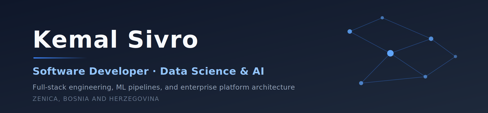

<!-- Banner: PNG for guaranteed rendering on GitHub. assets/header.svg is the editable source.
     Re-export to assets/header.png at 2400px wide after any edit. -->

  
  
  
  

---

I build production software at the point where application engineering meets machine learning. .NET and FastAPI services on one side, PyTorch pipelines and reinforcement learning on the other. Most of my work is about taking something undocumented and messy and turning it into a system with rules: an untangled enterprise platform, a scanned form that becomes a validated patient record, a scheduling policy you can actually verify.

Currently a **Software Developer** at GRAFiT BA and a **Teaching Assistant** at the Faculty of Electrical Engineering in Sarajevo, while finishing a BSc in **Data Science and Artificial Intelligence**.

### Now

| | |
| :--- | :--- |
| **Software Developer**, GRAFiT BA | Backend services in .NET and FastAPI, enterprise system integration, React Native clients |
| **Teaching Assistant**, ETF University of Sarajevo | Python, C++, Algorithms and Data Structures |
| **BSc Data Science & AI**, ETF University of Sarajevo | 2024 to present |

What I'm most interested in next: applied ML and data science roles, and backend or full-stack work on systems where correctness actually matters.

---

## Selected work

### [DSAI Vault](https://dsai3.pages.dev) &nbsp;·&nbsp; full-stack platform &nbsp;·&nbsp; built and run solo

Study site for the Data Science and AI programme at ETF Sarajevo: lecture notes, spaced-repetition flashcards, practice problems, past papers and exam plans, with LaTeX maths throughout. 39 courses, Google sign-in, progress saved per student. Students apply to become course educators and write content with an [AI-assisted toolkit](https://github.com/vrosi21/dsai-educator-kit) or an in-browser editor.

- Content as code: Markdown/YAML checked against Pydantic schemas, with errors that name the exact file and line, and every formula checked with KaTeX
- Web editor forms generated from the same schemas the validator uses. YAML edits rewrite only the changed lines, so comments and layout survive
- Git-like versioning: SHA-256 content-addressed storage, line-by-line diff history with one-click restore, and a command that replays web edits as git commits
- About 625 automated tests in GitHub Actions CI/CD, zero-downtime deploys to one Linux server, CSP, rate limits and role-based access

### [Prismo Cloud](https://github.com/vrosi21/prismo-cloud) &nbsp;·&nbsp; self-hosted media cloud &nbsp;·&nbsp; Go

My own Imgur/Giphy for screenshots, recordings, GIFs and stickers, on my VPS behind Cloudflare. Captures upload from the desktop, get thumbnails, MP4 and GIF versions, and are shared by private link or with specific Google accounts.

- Stateless Go API; clients upload straight to content-addressed S3 object storage (Garage) through presigned URLs
- PostgreSQL job queue (SKIP LOCKED + LISTEN/NOTIFY) feeding ffmpeg workers, so there is no separate queue service to run
- Windows desktop helper (Win32 + WebView2) with a hotkey picker that pastes any sticker into any chat app
- In-browser sticker maker that removes backgrounds on the device with U²-Net on ONNX Runtime Web

### [ListForge](https://github.com/vrosi21/list-forge) &nbsp;·&nbsp; LLM pipeline &nbsp;·&nbsp; trust boundaries

Product copy generation for multi-brand e-commerce. A language model drafts the listing, deterministic tested code decides whether that draft is approved, sent to a reviewer, or failed. Nothing publishes on the model's say-so.

- Every claim is checked against the product's own catalogue row: unsupported numbers, materials and origins, plus per-brand banned health claims, each finding recorded with its field and character span
- Two retry loops kept separate. Transport backs off with full jitter and never retries a client error; content re-asks the model with the exact validation errors
- Caches generations rather than verdicts, so tightening a rule re-grades earlier output at no model cost
- 14 of 14 planted violations caught, 0 of 6 clean cases flagged, behind 281 backend and 139 frontend tests in CI

### [Clarity](https://github.com/vrosi21/Clarity) &nbsp;·&nbsp; reinforcement learning + full-stack

A Kanban board with an embedded, from-scratch RL agent that assigns tickets based on workload, skill profile, and historical performance, instead of whoever grabs them first.

- Q-network written from scratch in NumPy (12-64-32-1, Adam, experience replay, target network) with Boltzmann exploration
- Sentence-transformer cosine similarity replaces one-hot skill encoding, cutting state dimensionality from 17 to 12
- Ticket lifecycle modelled as a 6-state DFA with machine-checked safety invariants; deadlock freedom verified by BFS over the LTS product state space
- Over 500 simulated sprints (~17.9k assignments) against a greedy baseline: **makespan −9.5%**, **blocking rate −43%**, **load variance −63%**

### [Medical Form OCR Pipeline](https://github.com/vrosi21/form-ocr-pipeline) &nbsp;·&nbsp; computer vision

A staged OCR pipeline for handwritten medical intake forms. It reads twenty fields per scanned form, corrects the raw reading in stages, matches the form against a patient database, and routes anything it is unsure about to human review.

- Four stages: fiducial-based affine registration → CLAHE preprocessing → per-field model routing (MNIST CNN + EasyOCR CRNN + pixel density) → weighted fuzzy record linkage
- Field accuracy improved from **20.8% to 98.0%**, with 100% patient-ID accuracy on held-out test data
- Fine-tuned the EasyOCR CRNN recogniser with CTC loss, using an augmentation-safe train/val split and validation-based checkpointing
- Tracked down why EasyOCR returned empty strings on single-character crops. The detection stage was the culprit, so I bypassed it and called the recogniser directly

### [kadJeBus](https://github.com/zeforgezenica/busez) &nbsp;·&nbsp; open source &nbsp;·&nbsp; data engineering

Public transit app for Zenica, built by the ZeForge Zenica community and live at [kadjebus.zeforge.ba](https://kadjebus.zeforge.ba). I worked on the ingestion side, turning scanned PDF timetables into the structured data the whole app runs on.

- Parsed and normalised scanned PDF timetables into relational JSON entities (routes, stations, agencies, cities) that serve as the application's only database, with no SQL layer underneath
- Records are schema-enforced with JSON Schema through AJV, so a malformed or misparsed timetable fails CI instead of reaching commuters
- Served from an Express REST API documented in Swagger/OpenAPI, with Jest and Supertest covering the endpoints on every push

---

## Also worth a look

| Project | What it is | Stack |
| :--- | :--- | :--- |
| **[vehicle-data-lab](https://github.com/vrosi21/vehicle-data-lab)** | Full ML pipeline predicting car prices from 3,045 OLX.ba listings: scraping, cleaning, EDA, modelling. RandomForestRegressor at ~9,985 BAM MAE; GradientBoostingClassifier at 67% accuracy with SMOTE. | Python · scikit-learn · Selenium |
| **[Path-Planning-Visualiser](https://github.com/vrosi21/Path-Planning-Visualiser)** | Interactive simulator showing how six search algorithms (BFS, Dijkstra, A\* and Weighted A\* among them) explore grids and find paths through weighted terrain. | Python · Pygame · PyQt6 |
| **[Cartel Detection in Public Procurement](https://github.com/uoloki/Anomaly-Detection-in-Procurement)** | Random Forest detecting bid-rigging cartels at **89.0% test ROC AUC** on the GTI Labelled Cartel Dataset, validated at bidder level so the score reflects unseen firms. The network-analysis branch is reported as a negative result. | Python · scikit-learn · Pandas |
| **[Trend Breaks with Semantic Signals](https://github.com/uoloki/Detecting-Trend-Breaks-with-Semantic-Signals)** | Short-term S&P 500 movement prediction fusing technical indicators with sentiment from financial posts, using sentence-transformer embeddings. | Python · PyTorch · sentence-transformers |
| **[TV-Image-Denoising](https://github.com/vrosi21/TV-Image-Denoising)** | Cross-platform C++20 desktop app comparing gradient descent (Armijo backtracking) with a Newton-type lagged diffusivity solver for total-variation denoising. Convergence and lambda studies, installers for Windows, macOS and Linux, written paper. | C++20 · CMake · natID |
| **[TSP-Solver](https://github.com/vrosi21/TSP-Solver)** | Team project: interactive Travelling Salesman solver on a map of the former Yugoslavia with Nearest Neighbour + 2-opt, Simulated Annealing and a Genetic Algorithm, stepping forward and back through every decision. | C++17 · CMake · natID |

## Open source

I contribute to [**ZeForge Zenica**](https://github.com/zeforgezenica), a local open-source community. Alongside kadJeBus above, I've worked on [**smetovi**](https://github.com/zeforgezenica/smetovi), an open-source site for the Smetovi mountain area near Zenica, built with Astro and deployed on Cloudflare Pages.

---

## Tech

**Languages** &nbsp;

**AI / ML** &nbsp;

Reinforcement learning · NLP · RAG and LLM tooling · ML pipelines · anomaly detection

**Backend** &nbsp;

**Frontend** &nbsp;

**Platform & DevOps** &nbsp;

Solution architecture · SOLID · CI/CD and release automation · formal verification (DFA / LTS / MDP) · architecture decision records

---

  <strong>English</strong> (fluent) &nbsp;·&nbsp; <strong>German</strong> (conversational) &nbsp;·&nbsp; <strong>Bosnian / Croatian / Serbian</strong> (native)
    
  <a href="https://linkedin.com/in/kemal-sivro">LinkedIn</a> &nbsp;·&nbsp;
  <a href="mailto:kemalsivro@gmail.com">Email</a>

